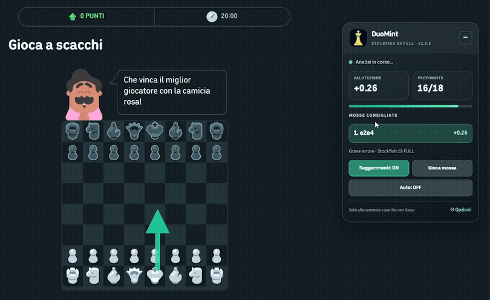

  

<h1 align="center">OscarKings</h1>

<strong>Stockfish 19 FULL meets Duolingo Chess.</strong>

An unofficial Chrome extension for local chess analysis and experiments against Oscar.

  
  
  
  

  
  

  <a href="https://github.com/Berserk-hub150/OscarKings/archive/refs/heads/main.zip"><strong>Download extension</strong></a> ·
  <a href="#live-demo">Demo</a> ·
  <a href="#installation">Installation</a> ·
  <a href="#responsible-use">Responsible use</a>

---

## Live demo

<strong>Stockfish 19 FULL vs Oscar</strong>

  

<a href="./oscarkings-readme.mp4">Watch the MP4 version</a>

Actual gameplay recording, cropped, sped up 5× and muted. The demonstration is against the computer-controlled Oscar, not other players.

## Features

| Feature | Description |
| --- | --- |
| Local chess engine | Stockfish 19 FULL runs on your device. |
| Move suggestions | Best-move arrows directly on the chessboard. |
| Position evaluation | Numerical score and evaluation bar. |
| Search settings | Adjustable analysis depth and search time. |
| Move analysis | Feedback on inaccuracies and mistakes. |
| Auto-move | Supported in lessons and matches against Oscar, not PvP. |
| Oscar rematch | Optional automated rematch against Oscar. |

## Installation

1. Download the [ZIP archive](https://github.com/Berserk-hub150/OscarKings/archive/refs/heads/main.zip) and extract it.
2. Open `chrome://extensions` in Chrome.
3. Disable older versions of DuoMint and enable **Developer mode**.
4. Choose **Load unpacked** and select the extracted directory containing `manifest.json`.
5. Reopen a Duolingo chess lesson or match against Oscar. The extension appears as **DuoMint**.

## Configuration

Open the DuoMint extension popup to adjust search depth (8–22), move suggestions, evaluation, move analysis and player color.

| Search preset | Approximate search time |
| --- | --- |
| Turbo | 0.6 s |
| Balanced | 1.2 s |
| Precise | 2.5 s |

The first engine startup may take longer. If the player color is detected incorrectly, choose White or Black manually. The Auto-move status field displays the last attempt.

## Responsible use

**OscarKings è un progetto indipendente, non ufficiale, senza affiliazione, approvazione o sponsorizzazione da parte di Duolingo.**

Il progetto è destinato alla sperimentazione tecnica e all'analisi scacchistica. Non è destinato a partite contro altri giocatori (PvP), ad aggirare le regole della piattaforma o a ottenere vantaggi sleali. Prima di utilizzarlo, verifica i termini di servizio e le regole applicabili.

Il software è fornito **così com'è**, senza garanzie espresse o implicite, nei limiti consentiti dalle licenze applicabili e dalla legge. L'utente è responsabile delle modalità di installazione, configurazione e utilizzo. Nei limiti consentiti dalla legge, gli autori e i manutentori declinano ogni responsabilità per uso improprio, danni, perdita di dati, sospensione o limitazione dell'account e altre conseguenze derivanti dall'uso del software. Nessuna clausola esclude responsabilità che non possano essere escluse per legge.

**English disclaimer:** OscarKings is an independent, unofficial project and is not affiliated with or endorsed by Duolingo. It is intended for technical experimentation and chess analysis, not PvP or unfair play. Users are responsible for complying with applicable platform rules and terms of service. The software is provided AS IS, without warranties, subject to applicable licenses and law. To the fullest extent permitted by law, authors and maintainers disclaim liability for misuse, damages, data loss, account restrictions or other consequences arising from use of the software. Nothing in this notice excludes liability that cannot lawfully be excluded.

## Credits and licenses

- ChessMint © 2022 thedemons. [Licenza MIT](CHESSMINT-LICENSE.txt).
- Stockfish.js 19 di Chess.com e dei contributori di Stockfish. [Sorgenti della versione 19.0.0](https://github.com/nmrugg/stockfish.js/tree/v19.0.0) · [Licenza GPLv3](STOCKFISH-GPL-3.txt).

---

<strong>Interested in the project? <a href="https://github.com/Berserk-hub150/OscarKings">Star OscarKings on GitHub.</a></strong>

